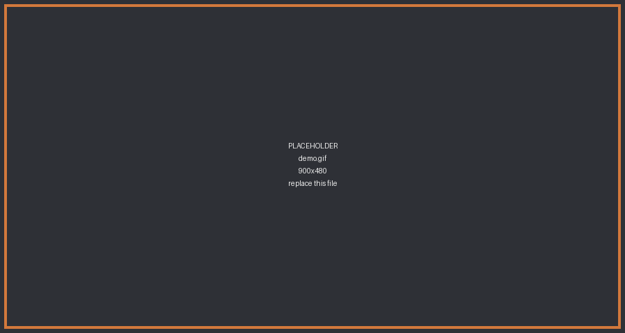
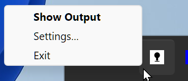
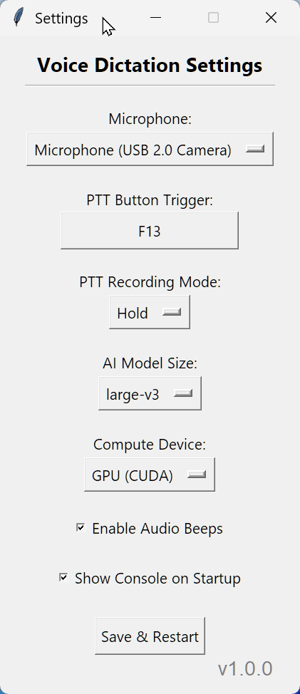

# Voice Dictation

Hold a button, talk, and your words get typed into whatever window you are
using. Everything runs on your own PC.

It is a small background app for Windows that sits in your system tray. Press
your push-to-talk button, say a sentence, release, and the text appears at your
cursor -- in your editor, your browser, a chat box, wherever you were already
typing.

## Why you might want it

- **Nothing leaves your machine.** No account, no API key, no audio uploaded
  anywhere. The speech model runs locally.
- **No subscription.** It uses OpenAI's Whisper model through
  [faster-whisper](https://github.com/SYSTRAN/faster-whisper), which is free.
- **Works in any app.** It types into whatever window has focus rather than
  integrating with specific programs.
- **You pick the button.** Any key or mouse button, set by pressing it.

## Installing

You need Windows 10 or 11 and [Python 3.10 or newer](https://python.org). When
you install Python, tick **"Add python.exe to PATH"** -- the installer hides it
at the bottom of the first screen and nothing works without it.

1. Download or clone this repository.
2. Run `vdict_install.bat`.
3. Wait. It downloads about 1.4GB of NVIDIA CUDA libraries so you do not have
   to install the CUDA toolkit yourself. On a slow connection this takes a
   while.
4. Launch **Voice Dictation** from the Desktop shortcut it creates.

Setup also adds the app to your Windows startup folder so it runs on login. If
you do not want that, run `startup_folder_uninstall.bat`.

The first time you dictate, the app downloads the speech model itself (about
140MB for the default). You get a notification when it starts and another when
it is ready.

## Using it

The default button is **middle mouse**, in **hold** mode: hold it down, speak,
let go. The text appears a moment later.

You will hear a short high beep when recording starts and a lower one when it
stops. Those are your cue that the app actually heard the button.

That is the whole daily loop. Everything below is optional.

### The tray icon

Look for the microphone near the clock. Double-click it to open the output
window, or right-click it for the menu.

| Tray menu | What it does |
|---|---|
| Show Output | Opens the output window |
| Settings... | Opens Settings without opening the output window first |
| Exit | Closes the app |

### The output window

A running log of what you dictated, plus a menu bar holding the rest of the app.
Minimizing it puts it back in the tray; closing it exits the app, and asks
before it does.

**File**

| Item | What it does |
|---|---|
| Save As... | Writes the log to a text file, named with today's date |
| Vocabulary... | Opens `vocabulary.txt` in your text editor -- see below |
| Settings... | Microphone, button, model, and the rest |
| Hide to Tray | Same as minimizing |
| Exit | Closes the app |

**Edit**

| Item | What it does |
|---|---|
| Copy | Copies the selected text (Ctrl+C) |
| Select All | Selects the whole log (Ctrl+A) |
| Copy All | Copies the whole log without selecting it first |
| Clear | Empties the log |

Right-clicking in the log also gives you Copy.

**View**

| Item | What it does |
|---|---|
| Zoom In | Bigger text (Ctrl++, or hold Ctrl and scroll the wheel) |
| Zoom Out | Smaller text (Ctrl+-) |
| Reset Zoom | Back to the default size (Ctrl+0) |

**Help**

| Item | What it does |
|---|---|
| Documentation | Opens this page in your browser (F1) |
| Error Log | Opens the error log. Greyed out when there is nothing to show |
| About | Version number and project link |

The window's size, position, and text size are remembered between runs.

### Settings

| Setting | Options |
|---|---|
| Microphone | Pick yours by name from the list -- no "system default" option |
| PTT Button Trigger | Click it, then press any key or mouse button to bind it -- left-click excepted |
| PTT Recording Mode | **Hold** (hold to talk) or **Toggle** (click to start, click to stop) |
| AI Model Size | tiny.en, base.en, small.en, medium.en, large-v3 |
| Compute Device | CPU or GPU -- GPU is greyed out if you have no NVIDIA card |
| Enable Audio Beeps | The start/stop tones |
| Show Output Window on Startup | Whether the output window opens on launch |
| Output Window Hotkey | Click it, then press a combination to raise the output window from anywhere. Unset by default |

Click **Save & Restart** to apply. Changing the model downloads it the first
time you use it.

In Toggle mode, a recording you forget about stops itself after two minutes and
plays a double beep.

### Teaching it words

Names, acronyms, and jargon often come out wrong. Add them, one per line, to
`userdata\vocabulary.txt` and the recognizer will favor those spellings.
**File > Vocabulary...** opens it for you.

Changes take effect on your next dictation. There is nothing to restart and
nothing to confirm -- save the file and carry on.

The file ships empty on purpose. Every word you add nudges the recognizer toward
it, so a long list of terms you never say can make them turn up in transcripts
where you did not say them. Add words as you hit problems, not in advance.

### Starting over

Delete `userdata\config.json` and relaunch. The app rebuilds it from its own
built-in defaults. That is also what it falls back on if `config.json` ever
gets corrupted.

## Which model and which device

A short sentence comes back in about a second on CPU with `base.en`.

If you have an **NVIDIA GPU**, use it. It is faster than that even running
`large-v3`, the largest and most accurate model, so you get better accuracy and
a shorter wait at the same time. There is no reason to run a small model on a
GPU.

On **CPU**, stay with `tiny.en`, `base.en`, or `small.en`. The larger models
work but are too slow to be pleasant for push-to-talk.

The app defaults to CPU and `base.en` so it runs on any machine. If the Compute
Device dropdown lets you pick GPU, your card was detected and you should switch.

The `.en` models are English-only and more accurate at English than the
similarly sized multilingual ones. `large-v3` handles other languages.

**What worked for me.** The built-in mic on a cheap webcam, two feet away, gave
poor accuracy. A conference-style desk mic fixed it -- it has been accurate
every time since, with a Roomba going round my chair, and it rejects sound from
behind, so a YouTube video on the same desk doesn't get transcribed.

## Known limitations

**It replaces your clipboard.** Text is delivered by copying it and sending
Ctrl+V, so whatever you had copied is gone after you dictate. If you copy a
link, dictate a sentence, then paste, you get the sentence. This is the next
thing on the list to fix.

**It cannot type into programs running as administrator.** Windows blocks
normal programs from sending input to elevated ones. Nothing appears and there
is no error. Run this app as administrator too if you need that.

**Middle-click scrolls in browsers.** If you keep the default button and use
Toggle mode in a browser, the click may trigger autoscroll. Hold mode is
generally fine; otherwise bind a different button.

**Very short presses are ignored.** Anything under 0.4 seconds is treated as an
accidental click and dropped, so a quick misclick will not stall anything.

**Background noise matters.** A distant or open mic picks up keyboards and room
noise, which shows up as invented words. A headset mic is noticeably better.

## If something goes wrong

**Nothing happens when I press the button.** Open the output window from the
tray and watch while you press it. If nothing appears, the button binding is not
what you think -- rebind it in Settings.

**"No Microphone Detected".** The mic it was set to use is gone. The Settings
window opens automatically; pick a different one and click Save & Restart.

**The app will not start.** Check `userdata\logs\tray_error.log`, or open it from
**Help > Error Log** if you can get the output window up. It is only
written when something actually fails, so if it exists, its last entry is your
answer. If that menu item is greyed out, no error has ever been recorded.

**Transcription is slow.** You are probably on CPU with a large model. Check the
Compute Device and AI Model Size settings.

**It typed something I did not say.** Whisper guesses when audio is unclear.
Check `vocabulary.txt` -- words listed there get favored, so a long list can
cause exactly this.

## How it works

Two processes. `vdict_tray.py` is the one you launch: it puts the icon in your tray
and owns the settings and output windows; it launches `vdict_daemon.py`, the daemon
that does the actual work.

The daemon uses [pynput](https://github.com/moses-palmer/pynput) to watch for
your push-to-talk button globally, records through
[sounddevice](https://python-sounddevice.readthedocs.io/) via WASAPI, and
transcribes with [faster-whisper](https://github.com/SYSTRAN/faster-whisper).
Audio is peak-normalized before transcription, which helps a quiet or distant
mic, and a voice-activity filter trims silence first.

Text is delivered by putting it on the clipboard and sending Ctrl+V, which is
fast and works nearly everywhere. Its drawbacks are in Known Limitations above.

CUDA libraries are found by scanning site-packages rather than requiring a
system CUDA install, which is why `vdict_install.bat` can pull them in with pip. On GPU,
pressing the button also fires a silent dummy transcription to wake the card up
while you are still talking, so the first word is not slower than the rest.

## Windows only, for now

Windows by design rather than by accident. Audio goes through WASAPI, the
single-instance guard uses the Win32 API, and text delivery moves to SendInput
in 1.1.

A Linux or macOS port would be genuinely welcome, so here is an honest map of
what you would be taking on.

**Straightforward**

- `winsound` tones -- sounddevice is already a dependency and can play audio
- The single-instance mutex -- any lockfile works
- DPI scaling through `ctypes.windll` -- Tk exposes this cross-platform
- `os.startfile` -- one small helper over `xdg-open` or `open`
- The `.bat` scripts -- rewrite as shell scripts

**The real work**

- Audio. Device enumeration is built around WASAPI because Windows lists every
  microphone once per host API, and `auto_convert` lets the OS resample to the
  16kHz Whisper needs. Neither has a direct equivalent, so expect a second
  implementation rather than a branch.

There is deliberately no platform abstraction layer. Writing one without a
second platform to test against would have handed you a broken seam to work
around instead of clean code to replace. Everything above is a handful of
direct call sites -- `grep` for `winsound`, `win32`, `windll`, `startfile`, and
`WASAPI` finds all of them.

Open an issue if you start one.

## 🤖 How this was built (The AI Disclaimer)

**Before you review the code, you should know:** I literally do not know how to write a "Hello World" script in Python. 

This entire application—including the threaded architecture, the CUDA memory management, and the Windows API hooks—was built from scratch in 14 days using Anthropic Claude. 

However, this was not generated by typing *"build me a dictation app"* into a chat box. It was built through rigorous, painfully derived AI instructions, strict architectural protocols, and relentless iteration. 

I am open-sourcing this not just because the tool is useful, but as a proof of concept. AI coding is not a fad, and it does not inherently produce "slop." When treated as a powerful tool and managed with strict architectural discipline, it allows a single person to build complex, commercial-grade systems in a fraction of the time.

## License

MIT. See [LICENSE](LICENSE).
